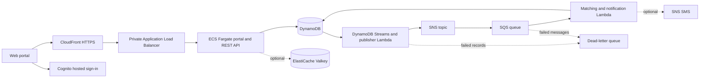

# RePlate on AWS

RePlate connects surplus-food donors with vetted NGOs and volunteer organizations. A second route connects organic biomass donors with approved processors. Donors publish a weight, preparation time, pickup deadline, address, and coordinates. Partners register a base location, claim eligible offers, and confirm collection.

## AWS architecture



- Cognito uses authorization code with PKCE. An administrator vets accounts and assigns one group. The portal only reveals pickup addresses to the donor or successful claimant.
- DynamoDB indexes open offers by route and deadline. For a new offer, Lambda queries geographic latitude bands and calculates great-circle distance. The closest five eligible partners within 35 km receive alerts.
- Conditional writes enforce the pickup deadline, material route, and one claimant. Confirming collection and increasing the impact totals happen in one transaction. Expired offers stay in donor history.
- In-app alerts are durable and deduplicated. The portal polls while open and can display desktop notifications with browser permission. Optional SNS SMS supports opted-in partners with a verified phone. SMS is best-effort.
- The impact dashboard counts confirmed food and biomass pickups separately. Its demonstration estimate uses 2.5 kg CO₂e per kg of collected food. It is a fixed assumption, and actual emissions depend on the food and disposal pathway.
- The biomass route catalogs, matches, and tracks feedstock collection. It ends at processor handoff. The two Lambda functions and the ECS service log to CloudWatch.

## Deploy to AWS

Use an authenticated AWS CLI profile, Terraform 1.10 or later, and Docker with Buildx. The default deployment region is Mumbai (`ap-south-1`). Fargate, the ALB and public IPv4 addresses have recurring costs while the stack runs. ElastiCache and SMS are disabled by default.

Run from the repository root. If using an AWS SSO profile, sign in with `aws sso login --profile <profile>` and export `AWS_PROFILE` before running these commands.

```bash
export AWS_REGION=ap-south-1
aws sts get-caller-identity

terraform -chdir=infra/bootstrap init
terraform -chdir=infra/bootstrap apply -var="region=$AWS_REGION"

REPLATE_ECR=$(terraform -chdir=infra/bootstrap output -raw repository_url)
REPLATE_STATE=$(terraform -chdir=infra/bootstrap output -raw state_bucket)
REPLATE_IMAGE="$REPLATE_ECR:dev-$(date +%s)"

aws ecr get-login-password --region "$AWS_REGION" |
  docker login --username AWS --password-stdin "${REPLATE_ECR%/*}"
docker buildx build --platform linux/amd64 --provenance=false --push -t "$REPLATE_IMAGE" .

terraform -chdir=infra init   -backend-config="bucket=$REPLATE_STATE" -backend-config="region=$AWS_REGION"
terraform -chdir=infra apply -var="region=$AWS_REGION" -var="image=$REPLATE_IMAGE"

REPLATE_URL=$(terraform -chdir=infra output -raw url)
curl -fsS "$REPLATE_URL/health"
printf '%s\n' "$REPLATE_URL"
```

If AWS requires account verification before creating the CloudFront distribution, apply with `-var=use_api_gateway=true` to use an API Gateway HTTPS endpoint connected to the same private load balancer. Use the same setting on subsequent applies or teardown.

For optional caching, add `-var=enable_cache=true` to the stack apply. This provisions a private TLS-enabled Valkey endpoint with a five-second cache for active offer IDs. DynamoDB remains authoritative for claiming. To enable SMS, apply with `-var=enable_sms=true`, configure SNS SMS origination and sandbox access as required for your destination country, and have an administrator record a verified E.164 phone number in Cognito. Partners then choose SMS in their matching-location settings. For India, check SNS’s country-specific sender and registration requirements before enabling delivery.

## Create demo users

Set the variables to email addresses you control. Cognito sends each user a temporary password.

```bash
REPLATE_POOL=$(terraform -chdir=infra output -raw user_pool_id)
export REPLATE_DONOR='donor@example.com'
export REPLATE_RECIPIENT='recipient@example.com'
export REPLATE_PROCESSOR='processor@example.com'

replate_invite() {
  aws cognito-idp admin-create-user --user-pool-id "$REPLATE_POOL"     --username "$1" --user-attributes "Name=email,Value=$1"     --desired-delivery-mediums EMAIL
  aws cognito-idp admin-add-user-to-group --user-pool-id "$REPLATE_POOL"     --username "$1" --group-name "$2"
}
replate_invite "$REPLATE_DONOR" donor
replate_invite "$REPLATE_RECIPIENT" recipient
replate_invite "$REPLATE_PROCESSOR" processor
```

1. Open the portal as the recipient and save a matching location. For example, enter latitude `30.356` and longitude `76.364`. Register the processor the same way in a separate browser profile.
2. Sign in as the donor and publish 12 kg of ready-to-eat food with nearby coordinates and a future deadline. The recipient can refresh to see the matching alert and available offer.
3. Claim it and open **My pickups**. Confirm collection after pickup. The donor’s history and the impact totals update. A second claimant gets a conflict.
4. Post a biomass offer at the same location and repeat with the processor. The biomass dashboard total changes independently of the food and CO₂e totals.

## GitHub Actions

[The workflow](.github/workflows/aws.yml) runs tests and Terraform validation on pull requests and pushes to `main`. To deploy from GitHub, bootstrap ECR and S3 once with the commands above. Configure the repository’s `aws` environment and an AWS IAM role for GitHub OIDC. Scope its trust to `repo:OWNER/REPOSITORY:environment:aws` with audience `sts.amazonaws.com`. Grant it access to the project’s ECR repository, S3 state and lock objects, and the AWS resources Terraform manages, including passing the project’s service roles.

Set `AWS_DEPLOY_ROLE_ARN`, `AWS_REGION`, `STATE_BUCKET`, and `ECR_REPOSITORY` in the GitHub environment variables. Optional environment variables are `STACK_NAME`, `ENABLE_CACHE`, and `ENABLE_SMS`. Run **RePlate AWS** manually and select **Apply the AWS stack**. The workflow publishes an immutable image tag, applies the stack using S3 state locking, and checks portal health.

## Local demo

```bash
python3 -m venv .venv
source .venv/bin/activate
pip install -r requirements.txt -r tests/requirements.txt
python demo.py
```

Open http://127.0.0.1:8080 and switch roles from the top bar. The demo starts with two food offers and a biomass offer. Select **NGO / volunteer**, claim a food offer, and confirm collection under **My pickups**. Select **Processor** for the biomass route. The server uses emulated DynamoDB, Streams, SNS and SQS. Demo records reset on restart.

## Local verification

```bash
python3 -m venv .venv
source .venv/bin/activate
pip install -r requirements.txt -r tests/requirements.txt
python -m unittest discover -s tests -v
node --check app/web/portal.js
terraform fmt -check -recursive infra
terraform -chdir=infra init -backend=false
terraform -chdir=infra validate
```

The local integration tests emulate the data and messaging services. They exercise publication through DynamoDB Streams, SNS and SQS, both routing paths, claim locking, expiration, and impact accounting. Live Cognito sign-in and SMS require the AWS stack.

## Tear down

Run `terraform -chdir=infra destroy -var="region=$AWS_REGION" -var="image=$REPLATE_IMAGE"` using the deployed settings. This deletes the portal, user pool and application data. Preserve any required data first. To remove the bootstrap stack too, separately remove the ECR images and all versions and delete markers from the state bucket before destroying `infra/bootstrap`.
